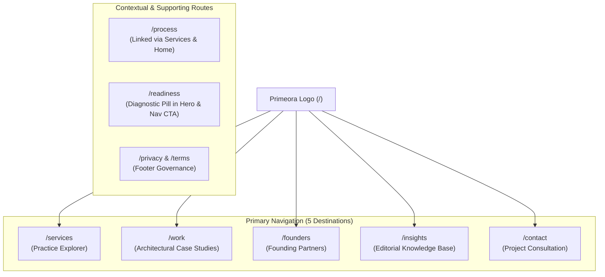

# Primeora Solutions — Creative Direction & Systems Design Specification (V3)

**Document Version:** 3.0.0  
**Date:** October 2026  
**Status:** Approved Architectural Specification  
**Design Concept:** *The Cinematic Systems Studio (V3 Reset)*

---

## 1. Creative Thesis & The V3 Paradigm Shift

Primeora Solutions rejects generic SaaS templates, repetitive 3-card grids, and gratuitous AI design tropes. In V3, Primeora presents itself not as a generic agency selling isolated web pages, but as an **authoritative Systems Engineering Consultancy** that unifies fragmented business presence into high-converting, automated, durable operational infrastructure.

### The 4 Pillars of the V3 Creative Reset:

1. **True Dual-Theme Differentiation:**
   - **Night Mode (Default):** Deep obsidian canvas (`#090807`), warm titanium elevations (`#141312`, `#1C1A18`), hair-thin structural dividers (`#242220`), warm terra-copper highlights (`#E07A5F`), and authentic cobalt (`#1065FF`) reserved strictly for the brand emblem and verified credentials.
   - **Day Mode (Editorial Ivory):** Genuinely light, warm linen and parchment canvas (`#FBF9F5`), crisp obsidian typography (`#191817`), soft elevated surfaces (`#FFFFFF` and `#F2EDE4`), warm slate borders (`#E5DDD0`), and rich terracotta accents (`#C25E38`). No black backgrounds survive in Day mode.

2. **Original Motion-Picture Hero (Not Cosmic Stock Video):**
   - Discard the generic Earth orbital video. Replace it with an authored, real-time kinetic system stream: **"Fragmented Digital Chaos → Automated Enquiry Pipeline → Unified Intelligence"**.
   - Visually choreographs raw inbound customer traffic and messages being captured, validated, triaged, and routed into WhatsApp, CRM, and executive analytics.
   - Runs at 60fps with instant poster fallback, live `Pause Motion` telemetry control, and strict `prefers-reduced-motion` compliance.

3. **Streamlined, High-Impact Homepage:**
   - Transform the homepage from an exhaustive 8-section manual into a sharp 5-section narrative:
     1. *Cinematic Hero:* Clear value proposition, one supporting sentence, 2 focused CTAs.
     2. *The Reality & The System:* Brief breakdown of operational bottlenecks vs. engineered sovereignty.
     3. *Interactive Practice Preview:* Typography-led asymmetric preview linking to `/services`.
     4. *Engineered Methodology:* Directional 4-step route preview linking to `/process`.
     5. *Founders & Project Consultation:* Restrained executive accountability preview linking to `/founders` with verified enquiry SLA: *"We aim to respond to enquiries within 1–2 business days."*
   - Relocate detailed TRS specifications, exhaustive FAQs, and assessment questionnaires to their dedicated routes.

4. **Distinct Visual Worlds for Every Important Route:**
   - **Home:** Motion-picture narrative, immediate value, concise typography.
   - **Services (`/services`):** Asymmetrical, typography-led practice explorer with interactive morphing architecture drawer.
   - **Service Detail (`/services/[slug]`):** Custom visual motifs tailored to each discipline (Digital Presence wireframe, Acquisition radar, Lead pipeline, Automation state machine, Telemetry console, Ongoing reliability dashboard).
   - **Process (`/process`):** Directional systems progression timeline with client input gates and deliverable milestones.
   - **Founders (`/founders`):** Human, confident, generous portrait framing, verified founding partner credentials, direct contact channels.
   - **Work (`/work`):** Visually led architecture case studies with context, decisions, and verified outcomes.
   - **Readiness (`/readiness`):** Focused, interactive 6-dimension diagnostic workspace with dual-horizon action roadmaps and copyable audit export.
   - **Insights (`/insights`):** Editorial publication layout with refined reading typography.
   - **Contact (`/contact`):** Purposeful consultation environment with live validation and prominent SLA.

---

## 2. Streamlined Navigation Architecture

---

## 3. Typography & Styling Rules

- **Serif Display Voice:** Newsreader / Playfair / Fraunces style for headlines with italicized accents.
- **Body Voice:** Inter (16px, 1.6 line height) for effortless readability.
- **Monospace Voice:** JetBrains Mono for exact telemetry: SLAs, timestamps, code payloads, Udyam registration numbers.
- **Strictly Banned:**
  - Gradient text
  - Eyebrow / kicker pills above headings
  - Identical 3-card icon-heading-text grids
  - Decorative particles and zero-offset glow halos
  - Unverified guarantees or claims
